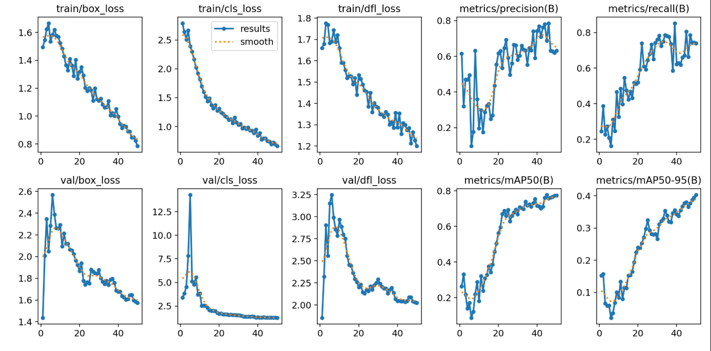
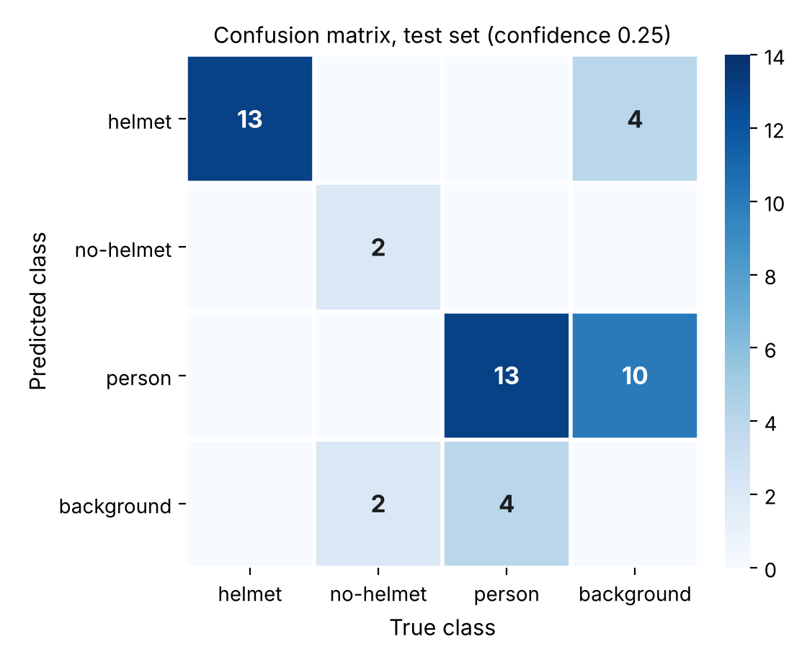

# Safety Helmet Detection with YOLOv8

An object-detection system that finds **helmets**, **bare heads (no helmet)** and **people** in photos, built with YOLOv8 as part of the AIRI Team PITB AI Internship (Task 1, Option B). It covers the full workflow: data collection, annotation in Roboflow, a YOLO-format dataset, training on Google Colab, evaluation, error analysis, and a small FastAPI + web demo.

The use case is basic road and workplace safety monitoring: flagging people who are not wearing a helmet.



## Classes

| ID | Class | Meaning |
|---|---|---|
| 0 | helmet | A helmet worn on a head |
| 1 | no-helmet | A bare or uncovered head |
| 2 | person | A person (rider or pedestrian) |

## Dataset

| Item | Value |
|---|---|
| Total images | 152 |
| Train / validation / test | 106 / 30 / 16 (about 70% / 20% / 10%) |
| Annotation | Roboflow Annotate, manual bounding boxes |
| Label format | YOLO: `class x_center y_center width height`, normalized to 0-1 |

**The dataset is not included in this repository.** The images come from Getty Images and Unsplash and cannot be redistributed. The notebook shows the full training setup.

### An annotation problem found and fixed

My first training run silently ignored most of its data. Roboflow's smart-polygon tool had produced polygon lines, and label files that mixed polygon and box lines were rejected as corrupt (73 of 106 training files, 16 of 30 validation files and 7 of 16 test files contained polygons). I converted every polygon to its bounding box, deleted the label cache and retrained. The results below are from the retrained model.

## Training setup

| Setting | Value |
|---|---|
| Model | YOLOv8n, pretrained (`yolov8n.pt`) |
| Epochs / image size / batch | 50 / 640 / 16 |
| Platform | Google Colab, Tesla T4 GPU |
| Training time | 2.1 minutes for the first run; the retrained model used the same settings |
| Library | Ultralytics 8.4.216 |

## Results

Final model (cleaned labels):

| Split | Images | Precision | Recall | mAP@0.5 | mAP@0.5:0.95 |
|---|---|---|---|---|---|
| Validation | 30 | 0.632 | 0.739 | 0.775 | 0.403 |
| Test | 16 | 0.830 | 0.648 | 0.735 | 0.395 |

Per class on the test set:

| Class | Instances | Precision | Recall | mAP@0.5 | mAP@0.5:0.95 |
|---|---|---|---|---|---|
| helmet | 13 | 0.839 | 0.802 | 0.886 | 0.484 |
| no-helmet | 4 | 0.867 | 0.500 | 0.682 | 0.406 |
| person | 17 | 0.784 | 0.642 | 0.637 | 0.294 |

The test set is small (16 images, 34 objects, only 4 no-helmet), so treat these numbers as indicative rather than precise.



The model found all 13 helmets and never confused a helmet with a bare head. Its mistakes are extra person boxes, a few extra helmet boxes, and missed objects (4 people and 2 no-helmet heads).

## Error analysis

At confidence 0.35 with a 50% overlap requirement, the 16 test images gave 26 correct detections, 8 missed objects, 6 false positives and no wrong-class errors. The main causes:

- **Inconsistent person labels.** Some person boxes include the motorcycle, others only the rider, so the model cannot learn one rule. This caused most poor-box errors.
- **Small and blurred objects**, such as tiny helmets on distant riders.
- **Crowded scenes**, where two overlapping riders were merged into one box.
- **A held helmet** being mistaken for a worn one.
- **Annotation mistakes**, including the mixed polygon and box labels.

### Ideas for improvement

1. Make the person labels consistent (rider only) and review every box.
2. Add more images for no-helmet, small or distant riders, motion blur, crowds and people holding helmets.
3. Annotate with bounding boxes only.
4. Train longer (100+ epochs) and compare YOLOv8n with YOLOv8s.
5. Add augmentation (flip, small rotation, brightness, blur) to the training split only.

## Demo (FastAPI + web page)

`demo/main.py` is a FastAPI server that loads the exported ONNX model and exposes `POST /predict` (image upload, with optional `conf` and `tta` parameters) and `GET /health`. `demo/index.html` is a page where you drop in a photo and get boxes, a verdict ("Helmet found" / "No helmet found"), a confidence slider and per-class toggles.

Close-up photos score low with this small dataset (a close-up selfie scored 0.12 for helmet, but 0.90 once the image was padded to look smaller), so the server retries on a zoomed-out copy when the first pass is not confident and keeps the better result.

Run it:

```bash
pip install -r requirements.txt
cd demo
# put the exported best.onnx in this folder
python -m uvicorn main:app --reload
```

Then open `index.html` in a browser. The page expects the API at `http://127.0.0.1:8000`.

## Repository structure

```
.
├── demo/
│   ├── main.py
│   └── index.html
├── notebooks/
│   └── helmet_training_notebook.ipynb   (outputs cleared)
├── figures/
│   ├── training_curves.png
│   └── test_confusion_matrix.png
├── models/                              (optional: exported best.onnx)
├── requirements.txt
├── LICENSE
└── README.md
```

## Reproduce the training

1. Open `notebooks/helmet_training_notebook.ipynb` in Google Colab and select a T4 GPU runtime.
2. Mount Google Drive and place your own dataset in YOLO format under `MyDrive/cv_project/dataset` (see the notebook for the folder layout and `data.yaml`).
3. Run the cells in order: install, dataset check, training, evaluation, predictions, error analysis.

Never commit your Roboflow API key. Use a placeholder in shared notebooks.

## License

The source code is released under the MIT License (see `LICENSE`). The training photographs belong to their respective owners and are not part of this repository.

## Acknowledgements

Model: [Ultralytics YOLOv8](https://github.com/ultralytics/ultralytics). Annotation: Roboflow. Images: Getty Images and Unsplash.
